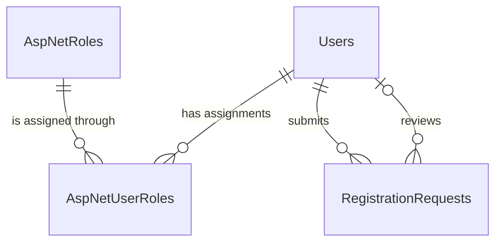
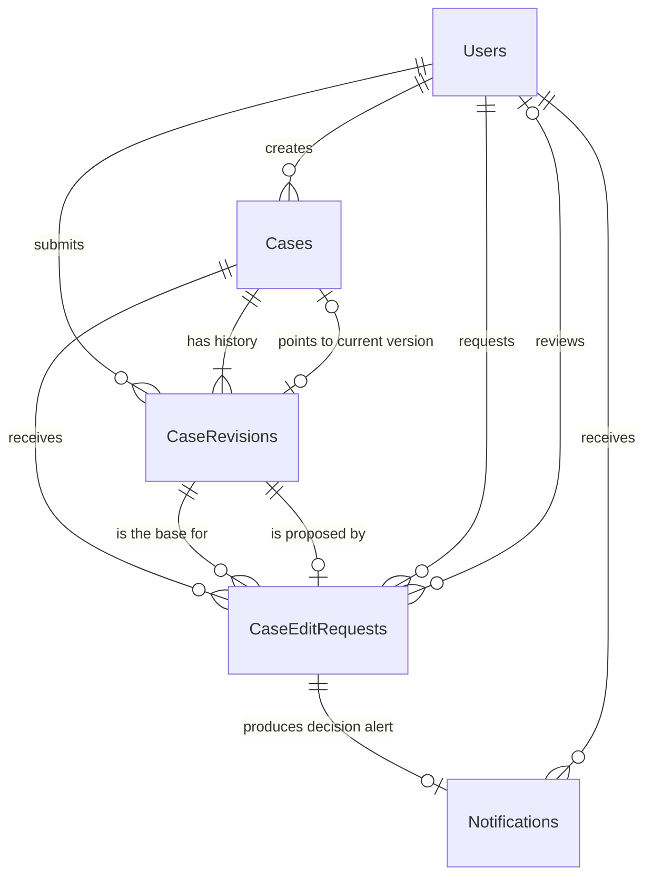
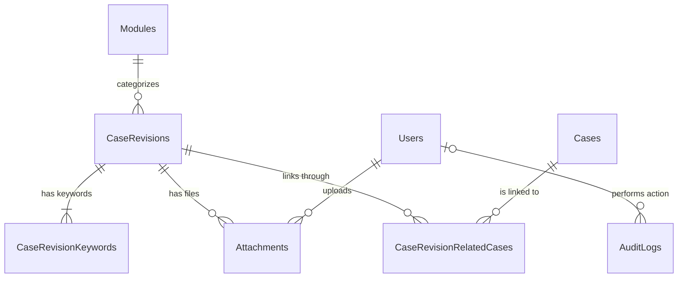

# ERP Knowledge Base — Database Design

**Status** · Draft for review  
**Database** · Microsoft SQL Server  
**Data access** · ASP.NET Core API and Entity Framework Core  
**Related document** · [System Design](<System Design.md>)

## 1. Overview

`Users` stores both employee and manager accounts. Role assignments determine who can review registrations, review edits, and view author identities. ASP.NET Core Identity manages authentication and credentials. Configure its Entity Framework Core mapping to use the SQL table name `Users` for the user entity.

`Cases` gives each case a permanent ID. `CaseRevisions` stores the documentation from the case form. The case's current published revision determines which version employees see when they open it.

## 2. Entity relationship diagrams

In these diagrams, `||` means exactly one, `o|` means zero or one, `o{` means zero or many, and `|{` means one or many.

### Accounts and registration approvals

### Cases, revisions, and edit requests

### Documentation details and audit events

The current-version pointer can be empty while the case and its first revision are being written in the same transaction. Every committed case in the MVP has a current published revision.

## 3. Accounts and approvals

**PK** means primary key and **FK** means foreign key.

| Table | Columns and keys |
|---|---|
| `Users` | `Id` (PK), `Email`, `NormalizedEmail` (unique for work-email accounts), `FullName`, `AccountStatus`, `CreatedAtUtc`, and credential fields managed by Identity. |
| `AspNetRoles` | `Id` (PK), `Name`, and Identity-managed role fields. The application uses `Employee` and `Manager`. |
| `AspNetUserRoles` | `UserId` (FK to `Users.Id`), `RoleId` (FK to `AspNetRoles.Id`). Together they form the PK. |
| `RegistrationRequests` | `RegistrationRequestId` (PK), `RequesterUserId` (FK to `Users.Id`), `Status`, `SubmittedAtUtc`, optional `ReviewedByUserId` (FK to `Users.Id`), optional `ReviewedAtUtc`, optional `DecisionNote`. |

| Record | States |
|---|---|
| User account | `Pending`, `Active`, `Rejected`, `Deactivated` |
| Registration request | `Pending`, `Approved`, `Rejected` |

1. Registration creates a pending account and a pending request.
2. An active manager approves or rejects the pending request. The API records the decision, reviewer, and time.
3. Approval activates the account and assigns the Employee role. Rejection leaves the account blocked.
4. Deactivation blocks protected access and preserves case history, audit records, and the original registration decision.

Write the registration decision, account status change, any role assignment, and the audit event in one transaction. Managers use the same account fields as employees. Provision the first manager through the controlled setup described in the system design.

## 4. Cases and documentation

### `Cases`

| Column | Purpose |
|---|---|
| `CaseId` | PK. Permanent ID used in case links and related cases. |
| `AuthorUserId` | FK to `Users.Id`. Identifies the original author for ownership checks. |
| `CreatedAtUtc` | When the case was created. |
| `CurrentPublishedRevisionId` | Identifies the current published revision of this case. |
| `RowVersion` | SQL Server `rowversion` used to detect concurrent updates. |

### `CaseRevisions`

| Column | Purpose |
|---|---|
| `RevisionId` | PK. Identifies one submitted version of the documentation. |
| `CaseId` | FK to `Cases.CaseId`. |
| `SubmittedByUserId` | FK to `Users.Id`. Identifies who submitted this revision. |
| `SubmittedAtUtc` | When the version was submitted. |
| `PublishedVersionNumber` | Version number within the case. Empty until publication. |
| `PublishedAtUtc` | Publication timestamp. Empty until publication. |

Each revision holds a complete snapshot of the case form.

| Form field | Required? | Storage |
|---|---|---|
| Title | Yes | `Title` |
| ERP module | Yes | `ModuleId` (FK to `Modules`) |
| Problem description | Yes | `ProblemDescription` |
| Error message | No | `ErrorMessage` |
| Root cause | No | `RootCause` |
| Solution | Yes | `Solution` |
| Troubleshooting steps | Yes | `TroubleshootingSteps` |
| SQL query or script | No | `SqlScript` |
| Explanation of the code | No | `CodeExplanation` |
| ERP version | No | `ErpVersion` |
| Verification steps | Yes | `VerificationSteps` |
| Warnings or risks | No | `WarningsAndRisks` |
| Keywords | At least one | One row per term in `CaseRevisionKeywords` |
| Attachments | No | One row per file in `Attachments` |
| Related cases | No | One row per link in `CaseRevisionRelatedCases` |

Use Unicode text for Arabic and English content. Long fields such as `SqlScript` can use `nvarchar(max)`. The application displays SQL snippets as text for reading and copying.

### Supporting tables

| Table | Columns and keys |
|---|---|
| `Modules` | `ModuleId` (PK), `Name`, optional `ArabicName`, `IsActive`. New submissions select an active module. Historical revisions retain their module reference. |
| `CaseRevisionKeywords` | `RevisionId` (FK), `NormalizedKeyword`, optional `DisplayKeyword`. PK is (`RevisionId`, `NormalizedKeyword`). |
| `CaseRevisionRelatedCases` | `RevisionId` (FK), `RelatedCaseId` (FK to `Cases`). Both columns form the PK. The API rejects self-links and validates that the target is published. |

Employees enter at least one keyword. The API trims and normalizes terms before saving them. A voucher case could use `cash sales voucher`, `zero total`, and `ACC_VOU_Vouchers`. Search also matches case content such as the title, error message, or problem description. Automatic keyword generation is outside this draft.

## 5. Edit requests and publication

A revision holds the proposed documentation. An edit request records who proposed it and how the manager decided.

| `CaseEditRequests` column | Purpose |
|---|---|
| `EditRequestId` | PK. |
| `CaseId` | FK to the case being edited. |
| `RequestedByUserId` | FK to `Users.Id`. Identifies the person submitting the proposal. |
| `BaseRevisionId` | Identifies the published revision the proposal started from. |
| `ProposedRevisionId` | Identifies the proposed snapshot. Unique across requests. |
| `Status` | `Pending`, `Approved`, or `Rejected`. |
| `SubmittedAtUtc` | When the request was submitted. |
| `ReviewedByUserId` | Optional FK to `Users.Id`. Identifies the reviewing manager. |
| `ReviewedAtUtc` | Optional review timestamp. |
| `DecisionNote` | Manager feedback. Required and nonblank on rejection, optional on approval. |

### In-app review and notifications

The manager queue queries pending `CaseEditRequests`. **Review request** loads `BaseRevisionId` and `ProposedRevisionId` for the side-by-side comparison. A stale base blocks approval.

| `Notifications` column | Purpose |
|---|---|
| `NotificationId` | PK. |
| `RecipientUserId` | FK to `Users.Id`. Must match the edit requester. |
| `EditRequestId` | FK to `CaseEditRequests`. Unique to prevent duplicate decision notifications. |
| `CreatedAtUtc` | When the decision notification was created. |
| `ReadAtUtc` | Optional timestamp set when the recipient marks it as read. |

Use the stored request status and `DecisionNote` to display the outcome and rejection feedback inside the notification. Index the recipient and creation time for inbox queries. Only the recipient can retrieve or mark the notification as read. The API requires a nonblank rejection note, and a database check enforces the same invariant for rejected requests. Write the decision, notification, audit event, and any publication change in one transaction. A rejected proposal remains unpublished.

### Walkthrough · Case #12

| Action | What the database records | What employees see |
|---|---|---|
| Hala publishes **Voucher total shows zero** | One case row and one revision row for version 1. The case points to version 1. | Version 1 |
| Hala updates her own solution | The case points to a newly published version 2. | Version 2. Version 1 remains in history. |
| A colleague proposes a clearer SQL explanation | A pending request links version 2 as the base to a new revision containing the proposed documentation. | Version 2 |
| A manager approves while version 2 is still current | The proposal becomes published version 3. The current pointer, review decision, notification, and audit event are written in one transaction. | Version 3 |

Rejection records the feedback, notifies the requester, preserves the proposed revision for authorized review and leaves the published version available. If the published version changes while a request is pending, the API blocks approval. The requester can submit an updated proposal based on the current version.

### Database and API rules

- Enforce same-case references for the current, base, and proposed revisions using composite FKs to the alternate key (`CaseId`, `RevisionId`).
- Use a filtered unique index on (`CaseId`, `PublishedVersionNumber`) for rows with a published version number.
- Preserve the submitted content, keywords, related links, and attachment associations as a snapshot. Publication updates the revision's publication fields.
- Review requests only while they are pending. An approval checks the base revision and the case's `RowVersion` within the transaction. Direct author edits use the same concurrency protection.
- Read current case content through `CurrentPublishedRevisionId`. Search only current published revisions. Published history includes earlier published versions.
- Restrict deletes where user, case, and revision references preserve history. Store timestamps in UTC.

## 6. Attachments, anonymity, and auditing

### Attachments

`Attachments` stores `AttachmentId` (PK), `RevisionId` (FK), `StorageKey`, `DisplayFileName`, `ContentType`, `SizeBytes`, `UploadedByUserId` (FK to `Users.Id`), `UploadedAtUtc`, and an optional checksum.

SQL Server stores metadata. The API stores the files in protected storage. A later revision can retain an existing file by adding its own attachment row with the same storage key. Keep the file while any retained revision references it. Back up the database and files together.

The API validates uploads, generates storage keys, and authorizes downloads against the associated revision.

### Author anonymity

The API checks `AuthorUserId` to determine whether the employee owns the case and can edit it directly. Employee responses for someone else's case omit author and contributor names, emails, and user IDs. The rule applies to case lists, search, published history, and attachment metadata. Employees can see whether they own a case. Authorized managers can access identities for review and auditing.

### Audit logs

`AuditLogs` stores `AuditLogId` (PK), optional `ActorUserId` (FK to `Users.Id`), `Action`, `TargetType`, `TargetId`, `Outcome`, `OccurredAtUtc`, and optional safe metadata. `TargetType` and `TargetId` identify the affected record.

Audit registrations, account decisions, deactivations, case publications, edit proposals, reviews, and relevant administrative changes. Restrict audit access to authorized managers. Exclude credentials, tokens, and file contents from audit metadata.

## 7. MVP verification

- [ ] A pending account has no protected access. An active manager can approve or reject its registration.
- [ ] A deactivated account loses protected access while its history remains available to authorized users.
- [ ] Publishing a case creates version 1. A direct author edit creates a new published version and preserves the earlier one.
- [ ] Pending and rejected proposals stay out of normal search and published history.
- [ ] Approval publishes a proposal only when its base remains current.
- [ ] A request can be decided once. Rejection requires feedback, and the notification is private to the requester and displays that feedback.
- [ ] Concurrent edits cannot silently overwrite a newer revision or publish duplicate version numbers.
- [ ] Historical revisions show their own keywords, related cases, and attachments.
- [ ] Case, history, search, and attachment responses preserve author anonymity for employees.
- [ ] Arabic text and SQL snippets display correctly. Downloads follow revision permissions.
